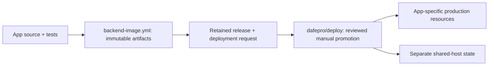

# Central production deployment

`dafepro/deploy` owns production deployment and shared infrastructure state.
Hosted dev is retired.
Local development and dev-tagged test fixtures remain available.

- `DEPLOY_REQUESTS_ENABLED` controls release requests. Request app infrastructure
  through `.deploy/infra/zoomigo.json` and the source request workflow.
- The source's cross-repository `DEPLOY_REQUEST_TOKEN` has Issues-write access only.
  Cloud, host and state credentials stay in trusted central controllers.
- Production releases share a central mutation lock and pinned SSH trust.
  App releases do not own the shared droplet lifecycle.
- Mac builds use the registered runner. `BUILD_RUNNER=github` or the manual
  `build_runner=github` input explicitly selects hosted Ubuntu; fork PRs remain hosted.
  See [Mac runners](MAC_RUNNERS.md) for registration and cache operations.
- Real-data, analytics and backup-custody approvals are independent of deployment ownership.

Canonical ownership, recovery and operational status:
[central state map](https://github.com/dafepro/deploy/blob/main/docs/state-separation.md).
