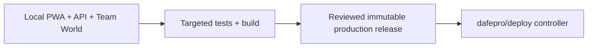

# Local development and qualification

Hosted dev is retired by owner decision. The former Worker, DNS and droplet are
managed through the retirement records in [dafepro/deploy](https://github.com/dafepro/deploy).

Use `pnpm dev`, `pnpm dev:team-world` and the local Docker test commands in
[README](../README.md). Local tests must use invented data and no cloud credentials.
Dev-tagged API fixtures and access-gate code remain available for local qualification.
Production credentials and real player data must never be copied into fixtures.

Production deployment authority and release evidence live in
[CENTRAL_DEPLOYMENT.md](CENTRAL_DEPLOYMENT.md). Local test success is not deployment.
