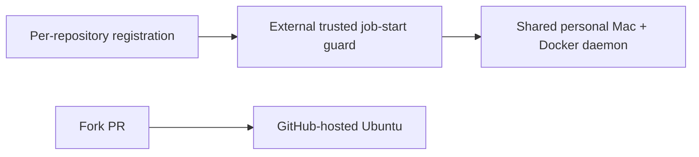

# Mac Actions runners

Register an owner repository with `github-mac-runner dafepro/REPOSITORY`, or reconcile
registrations with `github-mac-runner --all`. The maintained installer is
`scripts/install-mac-runner.sh`; it verifies the official archive checksum.
Labels: `self-hosted`, `macOS`, `ARM64`, `dcarrell-mac`.

- Registrations: `~/.local/share/github-mac-runners/dafepro--REPOSITORY`.
  ZoomiGo retains `~/.local/share/zoomigo-actions-runner`.
- Guard: `~/.local/share/github-mac-runners/guard`, outside mutable checkouts.
  It rejects foreign repositories, fork PRs and unsupported/mismatched events.
  Stop services before replacing reviewed guard files; update the bootstrap copy.
- Each registration uses `svc.sh status|stop|start`; logs are in `_diag`.
  Keep the Mac awake, logged in, connected and Docker Desktop running for Docker jobs.
- Registrations share CPU, RAM and Docker. Use repository-ID-scoped BuildKit builders;
  never globally prune Docker. Current cache targets: 6 GB, 1 GB reserved, 10 GB disk free,
  parallelism two. These are GC targets, not hard quotas.
- Per-service Git/GH/Docker configuration avoids interactive Keychain prompts.
  Docker login logs out after jobs. Keep credential stores outside checkouts.
- Mac jobs use local dependency/build caches; hosted jobs may upload caches.
  Use `pnpm/action-setup` destination `${{ runner.temp }}/pnpm`; private stores use
  five-minute fetch timeouts and four concurrent downloads.
- Use Docker CLI for Linux services and `--platform linux/amd64` for droplet images.
  GitHub job/service containers require a Linux runner.
